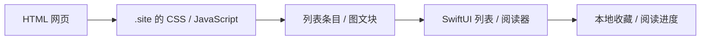

# Cove

把网页、NAS 与本地文件，放进同一个浏览与阅读空间。

Cove is a configurable iOS resource browser and reader for websites, SMB shares, and local files.

Cove 用 `.site` 配置描述网页的入口、内容和交互：普通页面用 CSS 选择器，复杂页面用 JavaScript，解析后的内容进入原生列表、播放器或阅读器。站点规则可以在 App 内编辑，应用代码无需为每个站点增加分支。

## 你可以用它做什么

- **浏览资源**：网站与 NAS 可切换列表、Bento、竖版布局；网站支持按规则配置分类、搜索与分页。
- **阅读和播放**：原生图文、TXT、EPUB、PDF、图片与 CBZ 漫画；视频与音乐播放，包含 Ogg Opus。NAS 音视频支持流式播放。
- **管理内容**：快速访问、收藏置顶与排序、继续阅读、离线下载；全局主题，TXT 翻页或滚动阅读。
- **管理配置**：交互式表单、完整 YAML 源码、网页点选与解析预览；解析卡住时查看当前原始网页。可通过授权的 [iCloud Drive 文件夹](docs/icloud-folder-sync.md)同步配置与资料。

## 从 HTML 到原生阅读

[Hacker News 示例](examples/sites/hacker-news.site)提供热门、最新、Ask HN 与 Show HN 入口。列表按标题行提取帖子，点击后将正文转换为原生段落、图片和链接；收藏和阅读进度保存在本地。评论在原网页中查看。链接帖可继续进入外部文章，正文提取失败时可打开原网页。

<table>
<tr>
<th>原始 HTML 页面</th><th>原生列表</th><th>原生图文阅读</th>
</tr>
<tr>
<td></td>
<td></td>
<td></td>
</tr>
</table>

截图来自实际运行的 Cove 和固定的离线演示页面，内容为虚构资料，不是线上 Hacker News 用户帖子。



一份 `.site` 使用当前唯一的 `schemaVersion: 1`：

| 字段 | 负责什么 |
| --- | --- |
| `id`、`name` | 稳定的站点身份与显示名称 |
| `match` | 匹配域名；规则还可按路径、查询参数匹配 |
| `entries` | 用户可以打开的入口 |
| `rules` | 每种页面的角色、加载、提取、分页与展示 |

列表规则设置 `contentType: article`，条目会进入图文阅读器；详情规则设置 `role: article`。正文可以直接用选择器描述：

```yaml
# rules 中的一条详情规则
- id: article
  role: article
  match: {pathPrefix: /posts/}
  extract:
    fields:
      title: {selector: h1, text: true}
      author: {selector: .author, text: true}
      blocks: {selector: article, content: true}
```

`content: true` 按 DOM 顺序提取段落、标题、图片、引用、代码和链接。复杂页面可以用 `extract.script` 返回相同的图文块结构。Hacker News 的标题与元信息位于相邻表格行，因此示例用 JavaScript 组合列表，正文仍用 CSS。

查看 [HTML → 原生阅读教程](docs/html-to-native.md)了解完整配置与结果结构，或查阅 [schema 参考](docs/site-format.md)。

## 开始使用

目前通过源码构建，目标为 **iOS 26+**。需要 Xcode（iOS 26 SDK 或更新）和 XcodeGen；依赖通过 Swift Package Manager 获取。模拟器可直接运行，安装到真机需自己的 Apple 开发签名。

```sh
cd EasyReader
xcodegen generate
open EasyReader.xcodeproj
```

在 Xcode 的 Signing & Capabilities 中选择自己的 Team；长期修改请同步到 `EasyReader/project.yml`，它是项目配置来源。选择模拟器或自己的设备运行。

首次运行可以没有任何站点配置。在「设置 → 管理网站」导入 [hacker-news.site](examples/sites/hacker-news.site)，也可以创建配置并用表单或 YAML 编辑。普通站点是否支持搜索、分页与正文，取决于该站点的规则和页面结构；外部文章的自动提取优先寻找 `article`、`main` 或 `[role=main]`。

可选的本地预置目录：

```text
sites/*.site             # 本地构建自动打包的站点规则
data/favorites.json      # 可选预置收藏
config/                  # 私有回归样本与工具资料
```

预置只在首次初始化导入一次；删除后不会自动重新添加。后续修改可在 App 内导入，或使用 iCloud Drive 文件夹同步。根目录的 `sites/`、`data/`、`config/` 和其他私有 `.site` 均被 Git 忽略；`examples/` 保存可提交的示例。应用数据位于 `Application Support/Cove/config` 和 `data`，NAS 密码留在 Keychain。

## 开发与验证

```sh
python3 scripts/test_export.py
cd EasyReader
xcodebuild -project EasyReader.xcodeproj -scheme EasyReader \
  -destination 'platform=iOS Simulator,name=iPhone 17 Pro' test
```

测试使用离线页面与 localhost；可选的私有回归样本放在 `config/site-tests/`，缺少样本时相关测试跳过。新增、删除或移动 Swift 文件后运行 `xcodegen generate`。

- [代码结构](docs/architecture.md)
- [站点规则测试](docs/site-tests.md)
- [缓存与性能](docs/performance.md)
- [审计修复记录](docs/review-status.md)
- [虚构站点配置](examples/sites/demo.site)与[预置收藏](examples/data/favorites.json)

RAR/CBR 尚无实际解码器；视频格式支持还取决于系统解码能力。X 尚未适配。真实站点登录、NAS 与真机性能需要实际环境验证。
