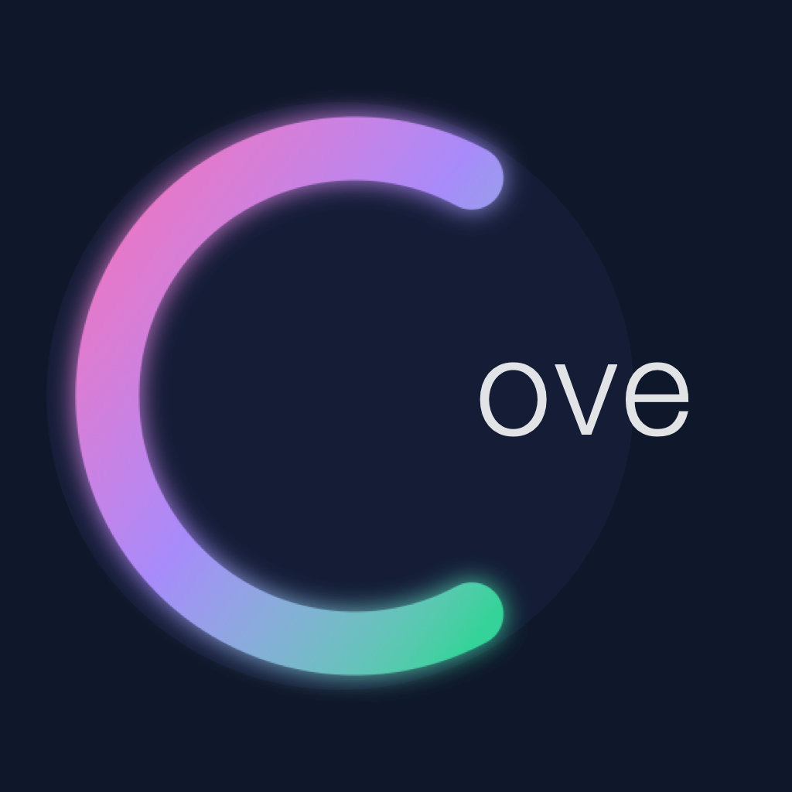
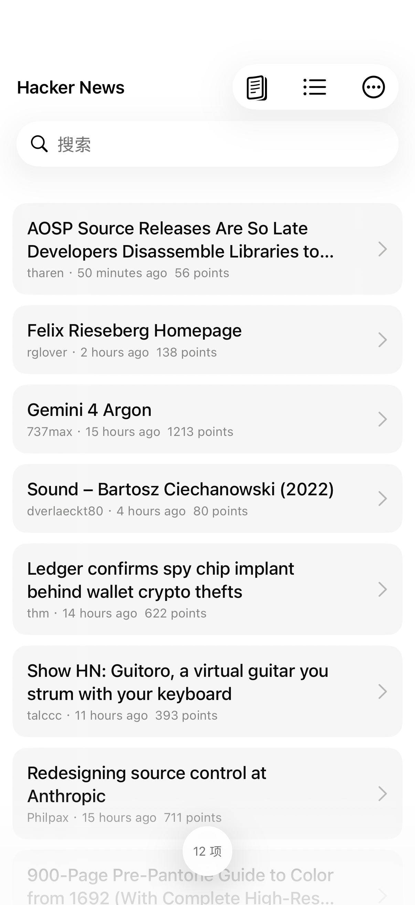
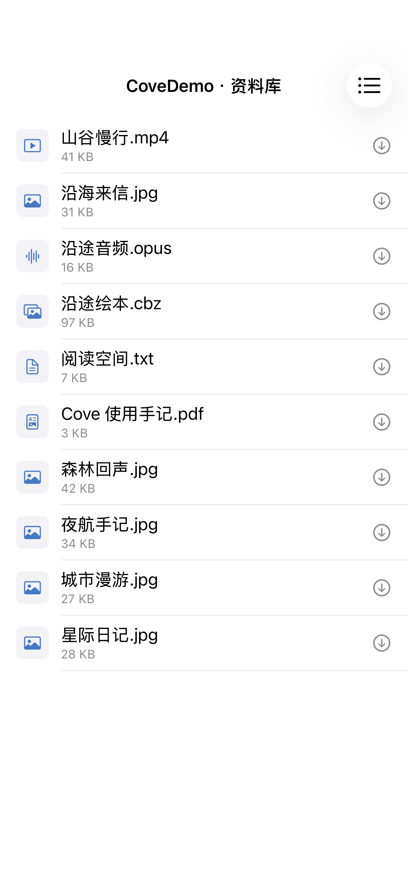
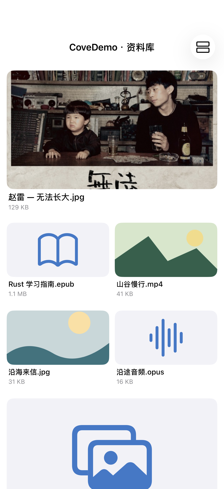
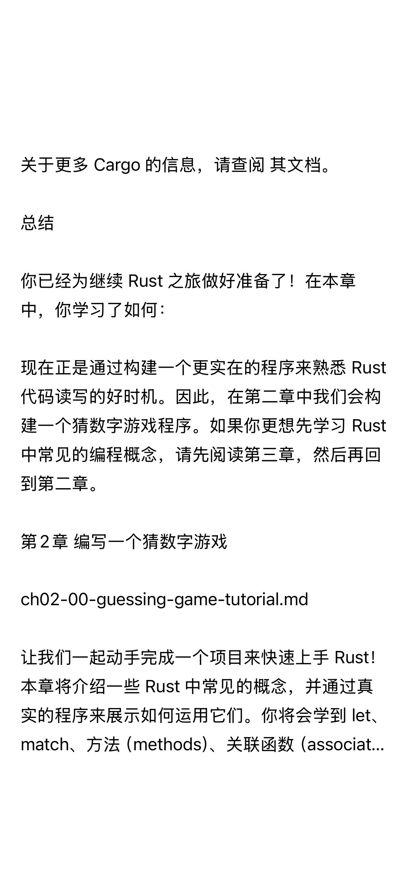
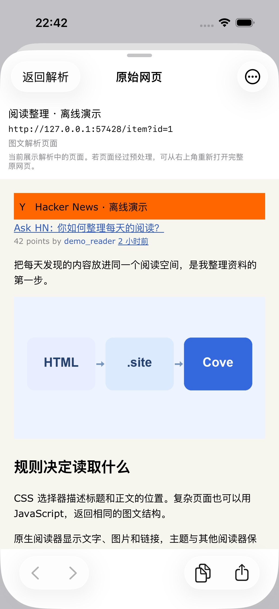
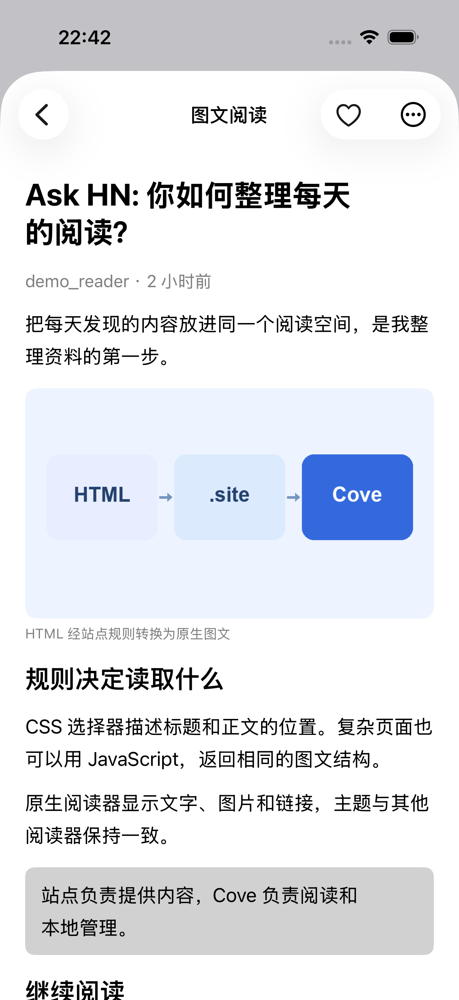

<p align="center">
  
</p>
<h1 align="center">Cove</h1>
<p align="center"><strong>网页、NAS、本地文件，都能好好读。</strong></p>
<p align="center">A configurable iOS browser and reader for your own content.</p>
<p align="center">
  <a href="#体验示例">体验示例</a> ·
  <a href="#从-html-到原生界面">HTML → 原生界面</a> ·
  <a href="#开始使用">开始使用</a>
</p>


读 Hacker News，翻开一本 Rust 学习指南，再听一首赵雷。也可以看视频、翻漫画，或继续 NAS 上的一本书。Cove 把不同来源的内容放进熟悉的浏览与阅读界面，收藏和阅读进度留在本地。

## 你的内容，你的阅读空间

| 来源与浏览 | 阅读与播放 | 整理与继续 |
| --- | --- | --- |
| 网页解析、SMB 与本地文件 | 原生图文、TXT、EPUB、PDF | 收藏置顶、手动排序、继续阅读 |
| 列表 / Bento / 竖版随时切换 | 图片与 CBZ 漫画、视频与音乐 | 离线下载、快速访问、全局主题 |
| 配置分类、搜索与分页 | NAS 音视频流式播放、Ogg Opus | TXT 翻页或滚动、[文件夹同步](docs/icloud-folder-sync.md) |

网站适配写在 `.site` 中：简单页面用 CSS，复杂页面用 JavaScript。在 App 里可以点选网页、预览解析结果，用表单或 YAML 编辑规则；遇到加载问题，可以打开当前原始网页排查。

## 体验示例

先看三种实际内容：公开 Hacker News 的首页快照、可打开的 Rust 学习指南，以及赵雷《成都》的公开试听。下面都是运行 Cove 后拍摄的界面。

<table>
<tr><th>Hacker News · 原生列表</th><th>TXT · 自动章节目录</th><th>赵雷 · 成都</th></tr>
<tr>
<td></td>
<td></td>
<td></td>
</tr>
</table>

| 示例 | 能体验什么 | 直接查看 |
| --- | --- | --- |
| **山海影库** | 视频缩略图、Bento、分类、搜索、下一页与播放 | [视频配置](examples/sites/local-video.site) |
| **漫游书架** | 竖版封面、漫画详情、章节与图片阅读 | [漫画配置](examples/sites/local-comic.site) |
| **沿途手记** | 原生图文、图片、链接、收藏与阅读进度 | [图文配置](examples/sites/local-journal.site) |
| **资源导航** | 从目录进入子列表，再打开资源 | [目录配置](examples/sites/local-directory.site) |
| **Hacker News** | 公开站点、JS 组合列表、CSS 正文提取 | [HN 配置](examples/sites/hacker-news.site) |
| **Rust 学习指南** | TXT 自动识别章标题、生成目录并分页 | [可打开的 TXT](examples/nas/files/Rust%20学习指南.txt) |
| **赵雷 · 成都** | 真实封面、曲目信息与公开试听播放器 | [素材来源与复现](examples/showcase/README.md) |
| **NAS 资料库** | SMB 浏览与流式播放，打开 CBZ / TXT / PDF / Opus | [NAS 指南与演示文件](examples/nas/README.md) |

HN 配置可以直接访问公开站点；Rust TXT 可放进 NAS 或本地资料目录，Cove 会从文本中的章节标题自动生成目录。音乐截图使用官方公开试听流，仓库保留封面与曲目信息。[截图来源与复现](examples/showcase/README.md)

四套本地网站配置继续提供视频、漫画、图文与目录的完整适配示范，真实私有规则不提交。启动服务后，在模拟器中的 Cove 导入 `examples/sites/local-*.site`：

```sh
python3 scripts/serve-examples.py
```

浏览器打开 `http://127.0.0.1:8765/`，可以看到同一份内容的原始网页。[完整示例指南](examples/README.md)包含真机局域网设置与验证说明。

### NAS：把共享目录变成资料库

把 [演示文件](examples/nas/files) 放进自己的 SMB 共享，在 Cove 的 NAS 页添加连接。目录中混合的视频、图片、漫画、小说、文档与音频会进入各自的播放器或阅读器，右上角可以切换浏览布局。

<table>
<tr><th>按文件浏览</th><th>按内容浏览</th></tr>
<tr>
<td></td>
<td></td>
</tr>
</table>

没有 NAS 也可以运行只读的 localhost SMB 示例，见 [NAS 示例指南](examples/nas/README.md)。截图使用实际生产视图与 SMB 请求；目录包含 Rust Book 简体中文版、赵雷专辑封面和固定测试资源。[截图来源](docs/assets/README.md)

### TXT：纯文本也能像书一样读

导入 [Rust 学习指南.txt](examples/nas/files/Rust%20学习指南.txt)，Cove 从独立的章标题识别出 22 章，自动生成可跳转的目录，再按字体、行距和屏幕尺寸分页。支持翻页和滚动阅读；文件没有预置章节索引。

<table>
<tr><th>从 TXT 自动生成目录</th><th>原生排版与继续阅读</th></tr>
<tr><td></td><td></td></tr>
</table>

## 从 HTML 到原生界面

一份 `.site` 描述入口、页面角色和解析规则，Cove 把解析结果交给原生列表、播放器或阅读器。应用代码无需为每个站点增加分支。


<table>
<tr><th>原始网页</th><th>原生列表</th><th>原生图文阅读</th></tr>
<tr>
<td></td>
<td></td>
<td></td>
</tr>
</table>

[Hacker News 示例](examples/sites/hacker-news.site)提供热门、最新、Ask HN 与 Show HN 入口。链接帖可以继续进入外部文章，评论在原网页中查看。以上截图是实际应用读取离线虚构页面的结果，不是线上用户帖子。

### schema 的四个部分

只有一个当前格式：`schemaVersion: 1`。

| 字段 | 负责什么 |
| --- | --- |
| `id`、`name` | 稳定的站点身份与显示名称 |
| `match` | 匹配域名；规则还可按路径和查询参数匹配 |
| `entries` | 可以打开的入口与分类 |
| `rules` | 页面角色、加载、提取、搜索、分页与展示 |

例如，一个 HTML 视频列表只需描述卡片、字段与布局：

```yaml
schemaVersion: 1
id: example.video
name: 我的影库
match: {hosts: [video.example]}
entries:
  - {id: films, name: 影库, path: /videos/, category: video}
rules:
  - id: films
    role: catalog
    contentType: video
    match: {pathPrefix: /videos/}
    presentation: {layout: bento}
    extract:
      items: article.media-card
      fields:
        title: {selector: .title, text: true}
        url: {selector: a, attribute: href}
        thumbnail: {selector: img, attribute: src}
```

详情页再补一条播放或阅读规则。图文正文可用 `blocks: {selector: article, content: true}` 按 DOM 顺序提取段落、标题、图片、引用、代码和链接。JavaScript 的 `extract.script` 返回相同的内容结构。

[完整 schema 参考](docs/site-format.md) · [HTML → 原生阅读教程](docs/html-to-native.md) · [可导入的完整示例](examples/README.md)

## 开始使用

目标为 **iOS 26+**。GitHub Actions 可生成未签名 IPA，下载后需自行签名安装；版本标签会生成 Release 草稿。[打包与发布流程](docs/release.md)

也可以通过源码构建，需要 Xcode（iOS 26 SDK 或更新）和 XcodeGen；依赖通过 Swift Package Manager 获取。模拟器可直接运行，安装到真机需自己的 Apple 开发签名。

```sh
cd Cove
xcodegen generate
open Cove.xcodeproj
```

在 Xcode 的 Signing & Capabilities 中选择自己的 Team；长期修改请同步到 `Cove/project.yml`，它是项目配置来源。项目、Swift 模块和 Scheme 均为 `Cove`；已安装应用的 Bundle ID 和 NAS Keychain 标识保持原值，以便覆盖升级保留资料与密码。

在「设置 → 管理网站」导入示例，也可以创建配置并用表单或 YAML 编辑。首次运行可以没有任何站点。普通站点的搜索、分页与正文能力取决于配置和页面结构。

<details>
<summary>本地预置与资料存储</summary>

```text
sites/*.site             # 本地构建自动打包的站点规则
data/favorites.json      # 可选预置收藏
config/                  # 私有回归样本与工具资料
```

预置只在首次初始化导入一次；删除后不会自动重新添加。后续可在 App 内导入，或使用 iCloud Drive 文件夹同步。根目录的 `sites/`、`data/`、`config/` 与其他私有 `.site` 均被 Git 忽略；`examples/` 保存可提交的示例。应用数据位于 `Application Support/Cove/config` 和 `data`，NAS 密码留在 Keychain。

</details>

## 开发与验证

```sh
python3 scripts/test_export.py
python3 scripts/test_examples.py
cd Cove
xcodebuild -project Cove.xcodeproj -scheme Cove \
  -destination 'platform=iOS Simulator,name=iPhone 17 Pro' test
```

测试使用离线页面与 localhost。可选私有回归样本放在 `config/site-tests/`，缺少时相关测试跳过。新增、删除或移动 Swift 文件后运行 `xcodegen generate`。

[代码结构](docs/architecture.md) · [规则测试](docs/site-tests.md) · [缓存与性能](docs/performance.md) · [审计修复](docs/review-status.md) · [品牌素材与设计工具](docs/brand/README.md)

RAR/CBR 尚无实际解码器；视频格式取决于系统解码能力。X 处于实验适配阶段，真实规则保存在本地私有配置；见 [动态图文说明](docs/dynamic-articles.md)。真实站点登录、NAS 与真机性能需要实际环境验证。
